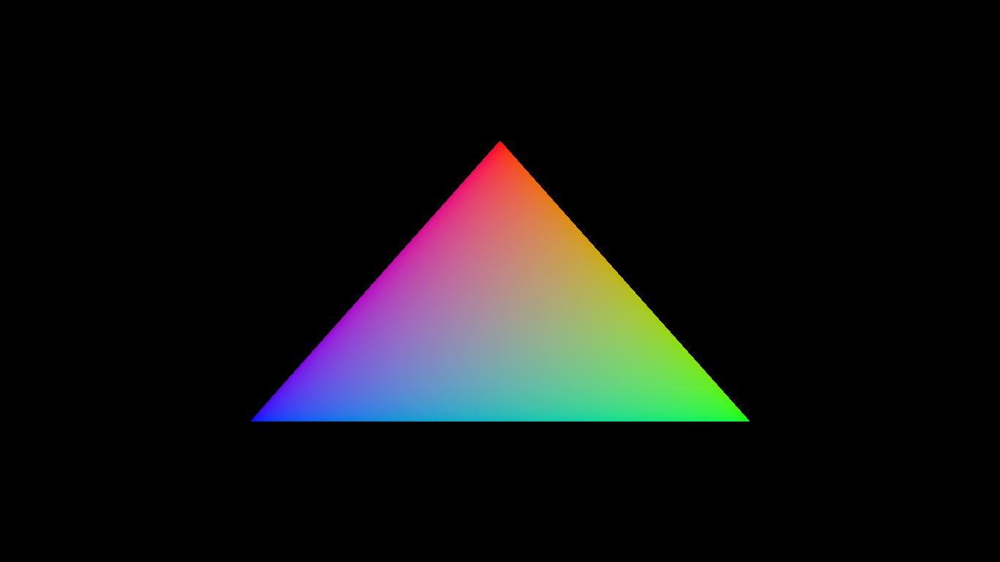

# GDRE

GDRE is a GPU driven rendering engine made in C++ 20 and Vulkan 1.4.



## Development dependencies:

- ### Vulkan SDK tarball

Download the SDK from https://vulkan.lunarg.com/sdk/home#linux. 
Then add the following line at the end of your `~/.profile` file:

```bash
source ~/Downloads/vulkansdk-linux-x86_64-1.4.x.x/1.4.x.x/setup-env.sh
```

- ### Git submodules

Install submodule dependencies running the following command in a terminal:

```bash
sudo apt install libx11-dev libxrandr-dev libxinerama-dev libxcursor-dev libxi-dev
```
